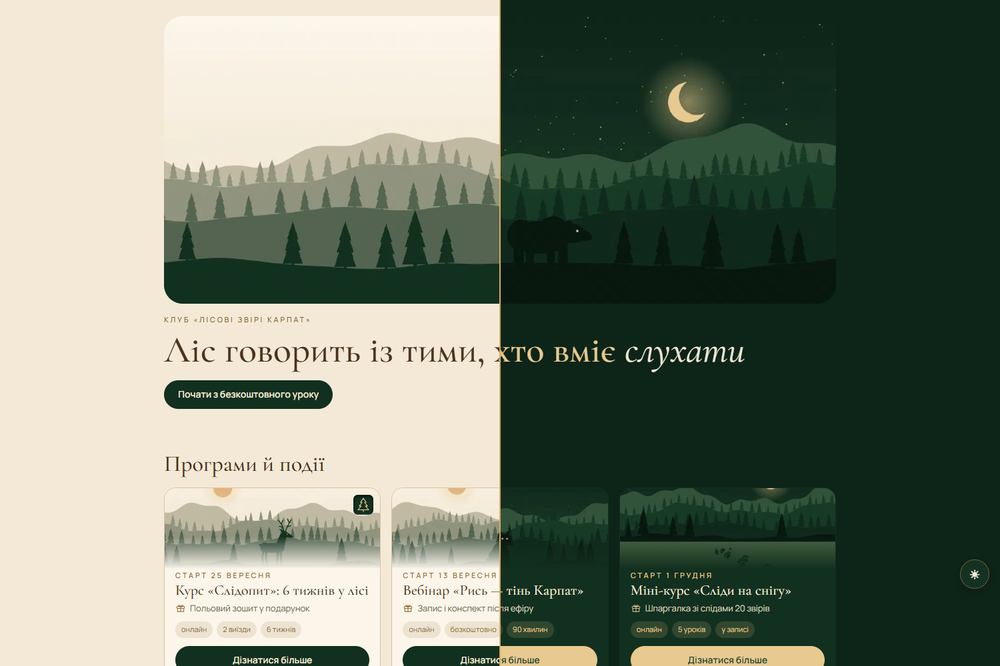

# hugo-checheta-theme



Hugo-тема (модуль) для сайту-воронки: програми, курси, вебінари й події з оплатою, листом очікування, безкоштовними уроками й сторінкою `/links` для соцмереж. Світла й темна теми, без cookies, тексти українською.

**Демо: <https://pervent.github.io/hugo-checheta-theme/>** — вигаданий клуб «Лісові звірі Карпат» з `exampleSite/`: по одній сторінці кожного типу з усіма заповненими полями. Локально: `hugo server --source exampleSite`. Демо публікується на GitHub Pages після зелених тестів на `main` (`.github/workflows/demo.yml`).

Тема працює й у підпапці (як демо на GitHub Pages): посилання в `menus`, `links`, `hero.cta` пиши від кореня сайту (`/about/`), тема сама додасть шлях з `baseURL`; у markdown-тексті сторінок — відносні посилання (`../contacts/`).

## Підключення

```yaml
# hugo.yml сайту
module:
  imports:
    - path: github.com/PerVenT/hugo-checheta-theme
```

Вимоги: Hugo extended ≥ 0.167.0, Go (для модулів).

## Локальна розробка разом із сайтом

У папці сайту (шлях відносний до його `themes/`; абсолютний шлях із `D:` Hugo не приймає):

```sh
HUGO_MODULE_REPLACEMENTS="github.com/PerVenT/hugo-checheta-theme -> ../../../../../Projects/themes/hugo-checheta-theme" hugo server
```

## Тести

Потрібні Hugo і Node ≥ 24, без npm-залежностей:

```sh
node --test "tests/**/*.test.mjs"
```

Тести збирають `exampleSite/` і перевіряють результат.

Перед кожним комітом хук `.githooks/pre-commit` збирає `exampleSite/` і запускає тести; помилка блокує коміт. Увімкнути один раз на клон:

```sh
git config core.hooksPath .githooks
```

Файл хука додавати з правом на виконання: `git add --chmod=+x .githooks/pre-commit`.

## Типи сторінок

| Сторінка | Як підключити | Поля |
| --- | --- | --- |
| Продукт | файл у `content/products/` | див. «Поля продукту» нижче |
| Уроки | `content/lessons/_index.md` + файл на урок | `id`, `youtube_id` (id або будь-яке посилання YouTube), `lead`, `weight`; обкладинка відео — і прев'ю посилання (`og_image` перевизначає) |
| «Дякую» | `layout: thanks` | `kind: payment` або `registration`, `lead`, `cta: {label, url}` (необов'язково); `sitemap: {disable: true}` |
| Юридична | `layout: legal` | `draft_legal: true` — банер «Чернетка» |
| Про мене | `layout: about` | `image`, `image_dark`, `lead` |
| Контакти | `layout: contacts` | `lead`; кнопки з `params.telegram.username`, `params.telegram_channel`, `params.email`; тіло — реквізити |

Порядок продуктів на головній, `/products/` і `/links`: спочатку закріплений (`pinned: true` — лише один на сайт, показується навіть після старту, ховається лише `status: close`), далі ті, що ще не стартували, — за `start`, далі без дати — за `weight`.

Меню: `menus.main` — у шапці (на всіх сторінках, крім головної), `menus.footer` і `menus.legal` — у футері.

Сторінки «дякую» мають `noindex`. Блок «Отримати підтвердження в Telegram» на «дякую — оплата» з'являється, лише коли задано `params.bot.username`.

## Поля продукту

Приклад з усіма полями — `exampleSite/content/products/mentorship.md`.

| Поле | Що це |
| --- | --- |
| `title`, `id` | Назва; стабільний ідентифікатор для аналітики й форм |
| `product_type` | `mentorship`, `mini`, `game`, `webinar` |
| `status` | `open` — оплата (вебінар — реєстрація), `waitlist` — «Скоро новий набір» з формою, `close` (або `closed`) — прихований зі списків |
| `start` | Дата старту (`2099-09-25` або `2099-09-13T19:00:00+03:00`); за 7 днів до неї з'являється відлік |
| `pinned: true` | Показувати першим, навіть після старту (лише один продукт); на картці й кнопці `/links` — вдавлений значок `favicon.svg` сайту |
| `price`, `payment: {mode, url}` | Ціна в грн на кнопці; посилання на кнопку WayForPay `https://secure.wayforpay.com/button/…`; `mode: link` — перехід на сторінку оплати, `widget` — оплата у вікні поверх сайту (без JS чи якщо віджет не завантажився — звичайний перехід), `checkout` — через `api.endpoint` (етап 3) |
| `lead` | Короткий опис під заголовком, він же опис для пошуковиків |
| `bonus`, `chips` | Рядок із подарунком і до 3 міток |
| картинка | `assets/images/products/<id>.(jpg\|jpeg\|png\|webp)` і `<id>-dark.(…)` для темної теми підхоплюються самі; `image` / `image_dark` у front matter — щоб узяти інший файл. Світла картинка, обрізана до 1200×630, — і прев'ю посилання в соцмережах (`og_image` у front matter перевизначає, без картинки — `params.og_image` сайту або головне фото `hero.image`) |
| `program[]: {title, text, items}` | Розгортувані блоки програми |
| `audience[]`, `results[]` | Списки «Для кого» й «Що ти отримаєш» |
| `testimonials[]: {image, name}` | Скриншоти відгуків (21:10) |
| `faq[]: {q, a}` | Питання й відповіді |

Текст після front matter виводиться під шапкою сторінки.

## Ліміти довжини полів

Збірка зупиняється з помилкою, якщо поле front matter довше за ліміт, напр.
`products\x.md: «chips» — разом 31 символів, максимум 30`. Рахуються символи з пробілами.
Таблиця — `data/limits.yml`; сайт може перевизначити її своїм `data/limits.yml`.

| Поле | Ліміт |
| --- | --- |
| `title` | 55 |
| `lead` (короткий опис під заголовком) | 160 |
| `bonus` | 40 |
| `chips` | до 3 шт., кожен ≤ 14, разом ≤ 30 |
| `program[].title` / `program[].items[]` | 45 / 80 |
| `audience[]`, `results[]` | 90 |
| `testimonials[].name` | 30 |
| `faq[].q` | 80 |
| `hero.label` / `hero.title` + `hero.accent` / `hero.cta.label` | 36 / 60 / 32 |
| `links[].label` | 32 |
| `role` (титул під іменем на /links) | 36 |

Текст зі списків, у якому є кома, пишіть стовпчиком (`- текст`), а не в `[…]` — інакше YAML розріже його на два пункти.

## Контракт форми

Форми (``, `lesson`, `waitlist`) надсилають `POST` з `Content-Type: application/json` на `params.forms.endpoint`:

```json
{
  "form": "webinar",
  "product_id": "webinar-rys",
  "fields": { "name": "…", "email": "…", "telegram": "…", "consent": "yes" },
  "utm": { "utm_source": "instagram", "utm_medium": "bio" },
  "page": "/products/webinar/",
  "ts": "2026-10-18T10:00:00.000Z"
}
```

- `fields` для `lesson` і `waitlist`: `name`, `contact`, `consent`.
- Будь-яка відповідь, крім 2xx, мережева помилка чи таймаут 8 с — відвідувачу показується посилання на Telegram (`params.telegram.username`), введені дані залишаються в полях.
- Приховане поле `website` (пастка для ботів) у `fields` не потрапляє; якщо воно заповнене, форма нічого не відправляє.
- Endpoint має дозволяти CORS для домену сайту.
